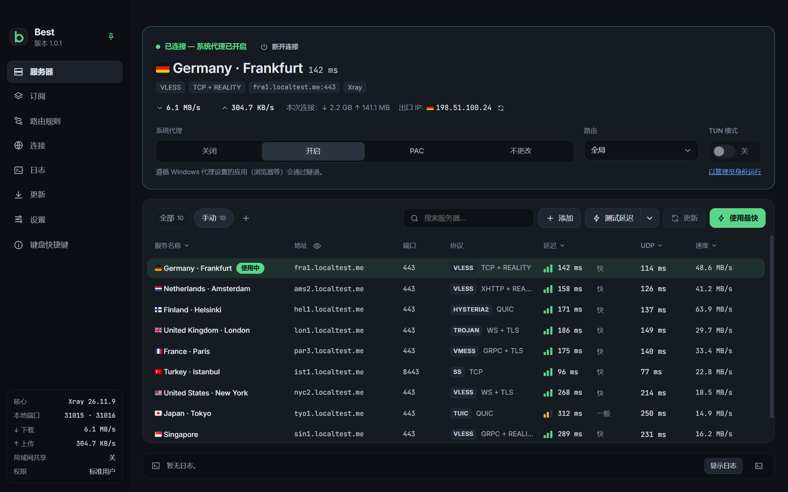

# Best

<details open>
<summary><b>English</b></summary>

A fast, private proxy client for Windows, built on Xray, sing-box and (optionally) mihomo.


**Download:** [Releases](../../releases/latest)

- `Best-Setup-vX.Y.Z.exe`: installer for all users (Program Files)
- `Best-vX.Y.Z-portable.zip`: portable copy (all data stays in its `data` folder)

**Everything is included:** the Xray and sing-box cores come inside the installer and the portable copy, so there is nothing else to download. The optional mihomo core installs with one click on the *Updates* page.

The SHA-256 of each file is shown next to it on the release page. Best checks it before it installs an update.

### What it does

- **Three cores, chosen for you.** Xray, sing-box and (optionally) mihomo. For each server, Best picks a core that can actually run it.
- **Every common link and subscription.** VLESS (REALITY, XHTTP, Vision, VLESS Encryption), VMess, Trojan, Shadowsocks (including 2022), Hysteria2, TUIC, WireGuard, AnyTLS, Naive, SOCKS and HTTP. Subscriptions can be plain links, base64, Clash / mihomo YAML or Xray JSON.
- **System proxy or TUN.** In TUN mode all apps go through the tunnel, DNS included. If the core stops, traffic stays blocked instead of leaking.
- **Routing.** Global, "my country direct" (for any country), direct, plus your own rules and ad blocking.
- **Tests.** Real delay, UDP and download speed. "Use fastest" picks the best server, and server groups switch on their own when one goes down.
- **Private by design.** Configs from subscriptions are cleaned before they run. Local ports listen on 127.0.0.1 only, sharing on the LAN always needs a password, and backups are encrypted.
- English, Русский, فارسی (right to left) and 中文, with several themes.

### Android (test version)

Best for Android (7.0 and newer) is in testing. Its releases are tagged `android-v…` and marked as pre-releases on the [Releases](../../releases) page.

- `Best-android-vX.Y.Z-arm64-v8a.apk`: almost every phone
- `Best-android-vX.Y.Z-armeabi-v7a.apk`: older 32-bit phones
- `Best-android-vX.Y.Z-x86_64.apk` / `-x86.apk`: emulators such as BlueStacks
- `Best-android-vX.Y.Z-universal.apk`: all of the above in one larger file

Every common link and subscription, routing, and encrypted backups (to a file or your own WebDAV server). VPN for every app or only the ones you choose, or proxy only. Xray, with sing-box for TUIC, AnyTLS and Naive. A quick-settings tile, a home-screen widget, QR codes, and updates from GitHub that are checked against their SHA-256 before they install.

To build it you need JDK 17, the Android SDK (platform 35) and Node.js 20 or newer. In the `android` folder, `node scripts/fetch-libs.mjs` and `node scripts/fetch-singbox.mjs` download the Xray library and sing-box (each checked by SHA-256), then `gradlew assembleDebug` builds the app.

### Build from source (developers only)

Only needed if you want to change the code yourself. To use Best, just download it above.

You need Windows 10 / 11 (64-bit), [Node.js](https://nodejs.org) 20 or newer and Git.

```
git clone https://github.com/Mo7amadd/Best.git
cd Best
npm install
```

The core programs are not kept in the repository. Download them from their own release pages and unpack:

- [Xray-core](https://github.com/XTLS/Xray-core/releases) (`Xray-windows-64.zip`): copy `xray.exe`, `geoip.dat`, `geosite.dat` and `LICENSE` to `resources\cores\xray`
- [sing-box](https://github.com/SagerNet/sing-box/releases) (`sing-box-…-windows-amd64.zip`): copy `sing-box.exe`, `libcronet.dll` and `LICENSE` to `resources\cores\sing-box`

Best 1.0.4 ships Xray 26.11.9 and sing-box 1.14.4.

- `npm start` runs Best.
- `npm test` runs the unit and fuzz tests. `npm run test:ui`, `test:perf` and `test:soak` drive the app itself.
- `npm run dist` builds the installer and the portable copy in `dist`.

### License

Best is free software under the [GNU General Public License v3.0 or later](LICENSE). The licenses of the components it ships are listed in [THIRD-PARTY-NOTICES](build/THIRD-PARTY-NOTICES.txt).

</details>

<details>
<summary><b>Русский</b></summary>

Быстрый и приватный прокси-клиент для Windows на основе ядер Xray и sing-box. Ядро mihomo можно установить дополнительно.


**Скачать:** в разделе [Releases](../../releases/latest)

- `Best-Setup-vX.Y.Z.exe`: установка для всех пользователей (в Program Files)
- `Best-vX.Y.Z-portable.zip`: портативная версия (все данные хранятся в папке `data` рядом с программой)

**Всё уже внутри:** ядра Xray и sing-box входят в установщик и портативную версию, больше ничего скачивать не нужно. Дополнительное ядро mihomo ставится в один клик на странице *Обновления*.

Контрольная сумма SHA-256 каждого файла указана на странице релиза. Best проверяет её перед установкой обновления.

### Возможности

- **Три ядра, Best выбирает сам.** Xray, sing-box и (по желанию) mihomo. Для каждого сервера Best выбирает ядро, которое действительно может его запустить.
- **Все распространённые ссылки и подписки.** VLESS (REALITY, XHTTP, Vision, VLESS Encryption), VMess, Trojan, Shadowsocks (включая 2022), Hysteria2, TUIC, WireGuard, AnyTLS, Naive, SOCKS и HTTP. Подписки: обычные ссылки, base64, YAML Clash / mihomo или JSON Xray.
- **Системный прокси или TUN.** В режиме TUN через туннель идут все программы, включая DNS. Если ядро останавливается, трафик блокируется, а не уходит напрямую.
- **Маршрутизация.** Глобальный режим, «моя страна напрямую» (для любой страны), напрямую, а также свои правила и блокировка рекламы.
- **Проверки.** Реальная задержка, UDP и скорость загрузки. «Самый быстрый» выбирает лучший сервер, а группы серверов сами переключаются, если сервер перестаёт работать.
- **Приватность.** Конфигурации из подписок очищаются перед запуском. Локальные порты открыты только на 127.0.0.1, доступ из локальной сети всегда требует пароль, резервные копии шифруются.
- English, Русский, فارسی (справа налево) и 中文, несколько тем оформления.

### Android (тестовая версия)

Best для Android (7.0 и новее) сейчас тестируется. Его выпуски помечены тегом `android-v…` и отмечены как предварительные (pre-release) на странице [Releases](../../releases).

- `Best-android-vX.Y.Z-arm64-v8a.apk`: почти все телефоны
- `Best-android-vX.Y.Z-armeabi-v7a.apk`: старые 32-битные телефоны
- `Best-android-vX.Y.Z-x86_64.apk` / `-x86.apk`: эмуляторы, например BlueStacks
- `Best-android-vX.Y.Z-universal.apk`: всё вместе в одном файле побольше

Все распространённые ссылки и подписки, маршрутизация и зашифрованные резервные копии (в файл или на свой сервер WebDAV). VPN для всех приложений или только для выбранных, либо только прокси. Xray, а для TUIC, AnyTLS и Naive — sing-box. Плитка быстрых настроек, виджет на главном экране, QR-коды и обновления с GitHub, которые проверяются по SHA-256 перед установкой.

Для сборки нужны JDK 17, Android SDK (платформа 35) и Node.js 20 или новее. В папке `android` команды `node scripts/fetch-libs.mjs` и `node scripts/fetch-singbox.mjs` скачивают библиотеку Xray и sing-box (каждый файл проверяется по SHA-256), затем `gradlew assembleDebug` собирает приложение.

### Сборка из исходного кода (только для разработчиков)

Это нужно, только если вы хотите сами менять код. Чтобы пользоваться Best, просто скачайте его выше.

Нужны Windows 10 / 11 (64-бит), [Node.js](https://nodejs.org) 20 или новее и Git.

```
git clone https://github.com/Mo7amadd/Best.git
cd Best
npm install
```

Программы ядер не хранятся в репозитории. Скачайте их со страниц релизов и распакуйте:

- [Xray-core](https://github.com/XTLS/Xray-core/releases) (`Xray-windows-64.zip`): скопируйте `xray.exe`, `geoip.dat`, `geosite.dat` и `LICENSE` в `resources\cores\xray`
- [sing-box](https://github.com/SagerNet/sing-box/releases) (`sing-box-…-windows-amd64.zip`): скопируйте `sing-box.exe`, `libcronet.dll` и `LICENSE` в `resources\cores\sing-box`

В Best 1.0.4 входят Xray 26.11.9 и sing-box 1.14.4.

- `npm start` запускает Best.
- `npm test` запускает модульные и фазз-тесты. `npm run test:ui`, `test:perf` и `test:soak` проверяют само приложение.
- `npm run dist` собирает установщик и портативную версию в папке `dist`.

### Лицензия

Best — свободная программа под лицензией [GNU General Public License v3.0 или новее](LICENSE). Лицензии входящих в неё компонентов перечислены в [THIRD-PARTY-NOTICES](build/THIRD-PARTY-NOTICES.txt).

</details>

<details>
<summary><b>فارسی</b></summary>

<div dir="rtl">

برنامه‌ی Best یک پروکسی سریع و امن برای ویندوز است که با هسته‌های Xray و sing-box کار می‌کند. هسته‌ی mihomo را هم می‌توان به‌دلخواه نصب کرد.


**دانلود:** از بخش [Releases](../../releases/latest)

- نصب برای همه‌ی کاربرها (در Program Files): <code dir="ltr">Best-Setup-vX.Y.Z.exe</code>
- نسخه‌ی پرتابل، همه‌ی داده‌ها کنار خود برنامه در پوشه‌ی <code dir="ltr">data</code> می‌ماند: <code dir="ltr">Best-vX.Y.Z-portable.zip</code>

**همه‌چیز همراه برنامه است:** هسته‌های Xray و sing-box داخل نصب‌کننده و نسخه‌ی پرتابل هستند و لازم نیست چیز دیگری دانلود کنید. هسته‌ی اختیاری mihomo هم با یک کلیک در صفحه‌ی *به‌روزرسانی* نصب می‌شود.

هش SHA-256 هر فایل در صفحه‌ی نسخه کنار آن آمده است و Best پیش از نصب هر به‌روزرسانی آن را بررسی می‌کند.

### امکانات

- **سه هسته، بدون دردسر انتخاب.** Xray، sing-box و به‌دلخواه mihomo. برنامه برای هر سرور هسته‌ای را انتخاب می‌کند که واقعاً آن را اجرا می‌کند.
- **همه‌ی لینک‌ها و اشتراک‌های رایج.** VLESS (با REALITY، XHTTP، Vision و VLESS Encryption)، VMess، Trojan، Shadowsocks (همراه 2022)، Hysteria2، TUIC، WireGuard، AnyTLS، Naive، SOCKS و HTTP. اشتراک می‌تواند لینک ساده، base64، YAML کلش و mihomo یا JSON ایکس‌ری باشد.
- **پراکسی سیستم یا TUN.** در حالت TUN همه‌ی برنامه‌ها و DNS از تونل رد می‌شوند. اگر هسته متوقف شود، ترافیک بسته می‌ماند و بیرون نمی‌رود.
- **مسیریابی.** همه از پروکسی، «کشور من مستقیم» (برای هر کشوری)، همه مستقیم، و قانون‌های دلخواه و مسدود کردن تبلیغات.
- **تست‌ها.** تأخیر واقعی، UDP و سرعت دانلود. «سریع‌ترین» بهترین سرور را انتخاب می‌کند و گروه سرورها وقتی سروری قطع شود خودشان سراغ سرور بعدی می‌روند.
- **حریم خصوصی.** کانفیگ‌های اشتراک پیش از اجرا پاک‌سازی می‌شوند. پورت‌های محلی فقط روی 127.0.0.1 باز هستند، اشتراک‌گذاری در شبکه‌ی محلی همیشه رمز دارد و پشتیبان‌ها رمزگذاری می‌شوند.
- فارسی (راست‌به‌چپ)، English، Русский و 中文، با چند تم.

### اندروید (نسخه‌ی آزمایشی)

برنامه‌ی Best برای اندروید (۷.۰ و بالاتر) در حال آزمایش است. نسخه‌های آن با تگ <code dir="ltr">android-v…</code> و به‌عنوان پیش‌انتشار (pre-release) در بخش [Releases](../../releases) قرار می‌گیرند.

- تقریباً همه‌ی گوشی‌ها: <code dir="ltr">Best-android-vX.Y.Z-arm64-v8a.apk</code>
- گوشی‌های قدیمی ۳۲ بیتی: <code dir="ltr">Best-android-vX.Y.Z-armeabi-v7a.apk</code>
- شبیه‌سازها مثل BlueStacks: <code dir="ltr">Best-android-vX.Y.Z-x86_64.apk</code> یا <code dir="ltr">-x86.apk</code>
- همه‌ی این‌ها در یک فایل بزرگ‌تر: <code dir="ltr">Best-android-vX.Y.Z-universal.apk</code>

همه‌ی لینک‌ها و اشتراک‌های رایج، مسیریابی، و پشتیبان رمزدار (در فایل یا روی سرور WebDAV خودتان). VPN برای همه‌ی برنامه‌ها یا فقط برنامه‌های انتخابی، یا فقط پروکسی. هسته‌ی Xray، و برای TUIC، AnyTLS و Naive هسته‌ی sing-box. کاشی تنظیمات سریع، ویجت صفحه‌ی اصلی، کد QR، و به‌روزرسانی از گیت‌هاب که پیش از نصب با SHA-256 بررسی می‌شود.

برای ساختن آن JDK 17، Android SDK (پلتفرم ۳۵) و Node.js نسخه‌ی ۲۰ یا بالاتر لازم است. در پوشه‌ی <code dir="ltr">android</code>، دستورهای <code dir="ltr">node scripts/fetch-libs.mjs</code> و <code dir="ltr">node scripts/fetch-singbox.mjs</code> کتابخانه‌ی Xray و sing-box را دانلود می‌کنند (هر کدام با SHA-256 بررسی می‌شود) و بعد <code dir="ltr">gradlew assembleDebug</code> برنامه را می‌سازد.

### ساخت از روی کد (فقط برای برنامه‌نویس‌ها)

فقط وقتی لازم است که بخواهید خودتان کد را تغییر دهید. برای استفاده از Best کافی است آن را از بالا دانلود کنید.

ویندوز ۱۰ یا ۱۱ (۶۴ بیتی)، [Node.js](https://nodejs.org) نسخه‌ی ۲۰ یا بالاتر و Git لازم است.

<div dir="ltr">

```
git clone https://github.com/Mo7amadd/Best.git
cd Best
npm install
```

</div>

برنامه‌های هسته در مخزن نیستند. آن‌ها را از صفحه‌ی انتشار خودشان دانلود و باز کنید:

- از [Xray-core](https://github.com/XTLS/Xray-core/releases) فایل <code dir="ltr">Xray-windows-64.zip</code>: فایل‌های <code dir="ltr">xray.exe</code>، <code dir="ltr">geoip.dat</code>، <code dir="ltr">geosite.dat</code> و <code dir="ltr">LICENSE</code> را در <code dir="ltr">resources\cores\xray</code> بگذارید.
- از [sing-box](https://github.com/SagerNet/sing-box/releases) فایل <code dir="ltr">sing-box-…-windows-amd64.zip</code>: فایل‌های <code dir="ltr">sing-box.exe</code>، <code dir="ltr">libcronet.dll</code> و <code dir="ltr">LICENSE</code> را در <code dir="ltr">resources\cores\sing-box</code> بگذارید.

نسخه‌ی 1.0.4 برنامه با Xray 26.11.9 و sing-box 1.14.4 منتشر شده است.

- دستور <code dir="ltr">npm start</code> برنامه را اجرا می‌کند.
- دستور <code dir="ltr">npm test</code> تست‌های واحد و تست‌های بازی (fuzz) را اجرا می‌کند. دستورهای <code dir="ltr">npm run test:ui</code>، <code dir="ltr">test:perf</code> و <code dir="ltr">test:soak</code> خود برنامه را آزمایش می‌کنند.
- دستور <code dir="ltr">npm run dist</code> نصب‌کننده و نسخه‌ی پرتابل را در پوشه‌ی <code dir="ltr">dist</code> می‌سازد.

### مجوز

برنامه‌ی Best نرم‌افزار آزاد است و با مجوز [GNU General Public License نسخه‌ی ۳ یا بالاتر](LICENSE) منتشر می‌شود. مجوز اجزایی که همراه آن هستند در [THIRD-PARTY-NOTICES](build/THIRD-PARTY-NOTICES.txt) آمده است.

</div>

</details>

<details>
<summary><b>中文</b></summary>

Best 是一款快速、注重隐私的 Windows 代理客户端，基于 Xray 和 sing-box 内核，也可以另外安装 mihomo 内核。



**下载：** 在 [Releases](../../releases/latest) 页面

- `Best-Setup-vX.Y.Z.exe`：为所有用户安装（Program Files）
- `Best-vX.Y.Z-portable.zip`：便携版（所有数据都保存在它的 `data` 文件夹中）

**一切都已包含：** 安装程序和便携版已内置 Xray 和 sing-box 内核，无需另外下载。可选的 mihomo 内核可在“更新”页面一键安装。

每个文件的 SHA-256 校验值显示在发布页面上，Best 在安装更新前会先校验。

### 功能

- **三个内核，自动选择。** Xray、sing-box 以及（可选的）mihomo。Best 会为每个服务器选择真正能运行它的内核。
- **支持所有常见链接和订阅。** VLESS（REALITY、XHTTP、Vision、VLESS Encryption）、VMess、Trojan、Shadowsocks（包括 2022）、Hysteria2、TUIC、WireGuard、AnyTLS、Naive、SOCKS 和 HTTP。订阅可以是普通链接、base64、Clash / mihomo YAML 或 Xray JSON。
- **系统代理或 TUN。** 在 TUN 模式下，所有应用（包括 DNS）都经过隧道。如果内核停止，流量会被阻断，而不会泄漏。
- **路由。** 全局、“本国直连”（任何国家均可）、直连，以及自定义规则和广告拦截。
- **测试。** 真实延迟、UDP 和下载速度。“使用最快”会选出最好的服务器，服务器组在某个服务器失效时会自动切换。
- **注重隐私。** 来自订阅的配置在运行前会被清理。本地端口只监听 127.0.0.1，局域网共享始终需要密码，备份经过加密。
- English、Русский、فارسی（从右到左）和中文，并有多种主题。

### Android（测试版）

Best for Android（Android 7.0 及以上）正在测试中。它的版本标签为 `android-v…`，在 [Releases](../../releases) 页面上标记为预发布（pre-release）。

- `Best-android-vX.Y.Z-arm64-v8a.apk`：几乎所有手机
- `Best-android-vX.Y.Z-armeabi-v7a.apk`：较旧的 32 位手机
- `Best-android-vX.Y.Z-x86_64.apk` / `-x86.apk`：BlueStacks 等模拟器
- `Best-android-vX.Y.Z-universal.apk`：以上全部合在一个较大的文件中

支持所有常见链接和订阅、路由，以及加密备份（保存到文件或你自己的 WebDAV 服务器）。可以让所有应用或只让选定的应用使用 VPN，也可以只用代理。由 Xray 运行，TUIC、AnyTLS 和 Naive 使用 sing-box。快捷设置磁贴、主屏幕小部件、二维码，以及来自 GitHub 的更新（安装前会校验 SHA-256）。

构建需要 JDK 17、Android SDK（平台 35）和 Node.js 20 或更新版本。在 `android` 文件夹中，`node scripts/fetch-libs.mjs` 和 `node scripts/fetch-singbox.mjs` 会下载 Xray 库和 sing-box（每个都经过 SHA-256 校验），然后 `gradlew assembleDebug` 构建应用。

### 从源代码构建（仅限开发者）

只有在您想自己修改代码时才需要。如果只是使用 Best，直接从上面下载即可。

需要 Windows 10 / 11（64 位）、[Node.js](https://nodejs.org) 20 或更新版本以及 Git。

```
git clone https://github.com/Mo7amadd/Best.git
cd Best
npm install
```

内核程序不保存在仓库中。请从它们各自的发布页面下载并解压：

- [Xray-core](https://github.com/XTLS/Xray-core/releases)（`Xray-windows-64.zip`）：将 `xray.exe`、`geoip.dat`、`geosite.dat` 和 `LICENSE` 复制到 `resources\cores\xray`
- [sing-box](https://github.com/SagerNet/sing-box/releases)（`sing-box-…-windows-amd64.zip`）：将 `sing-box.exe`、`libcronet.dll` 和 `LICENSE` 复制到 `resources\cores\sing-box`

Best 1.0.4 附带 Xray 26.11.9 和 sing-box 1.14.4。

- `npm start` 运行 Best。
- `npm test` 运行单元测试和模糊测试。`npm run test:ui`、`test:perf` 和 `test:soak` 对应用本身进行测试。
- `npm run dist` 在 `dist` 中构建安装程序和便携版。

### 许可证

Best 是自由软件，采用 [GNU General Public License v3.0 或更高版本](LICENSE) 许可。它附带组件的许可证列在 [THIRD-PARTY-NOTICES](build/THIRD-PARTY-NOTICES.txt) 中。

</details>
