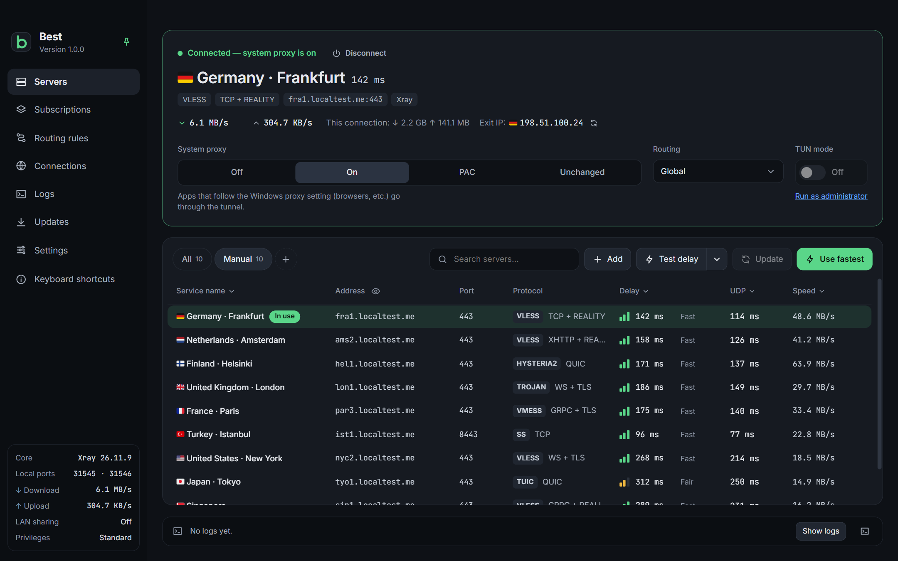
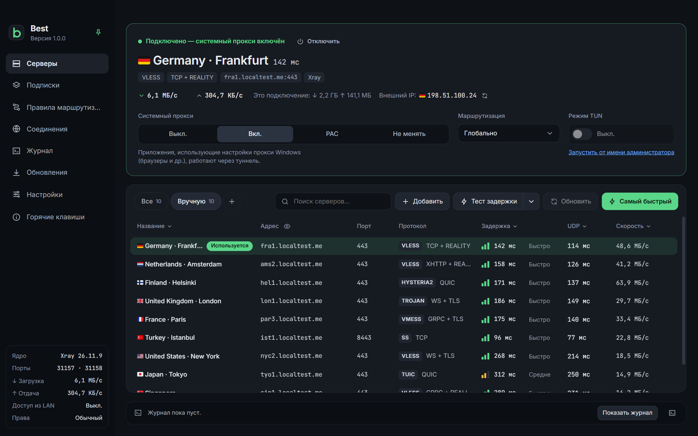
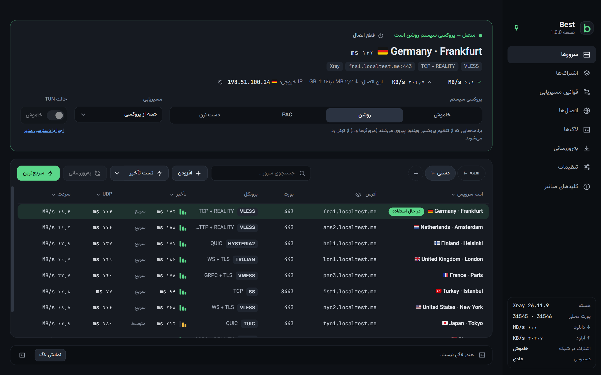

# Best

<details open>
<summary><b>English</b></summary>

A fast, private proxy client for Windows, built on Xray, sing-box and (optionally) mihomo.



**Download:** [Releases](../../releases/latest)

- `Best-Setup-vX.Y.Z.exe`: installer for all users (Program Files)
- `Best-vX.Y.Z-portable.zip`: portable copy (all data stays in its `data` folder)

The SHA-256 of each file is shown next to it on the release page. Best checks it before it installs an update.

### What it does

- **Three cores, chosen for you.** Xray, sing-box and (optionally) mihomo. For each server, Best picks a core that can actually run it.
- **Every common link and subscription.** VLESS (REALITY, XHTTP, Vision, VLESS Encryption), VMess, Trojan, Shadowsocks (including 2022), Hysteria2, TUIC, WireGuard, AnyTLS, Naive, SOCKS and HTTP. Subscriptions can be plain links, base64, Clash / mihomo YAML or Xray JSON.
- **System proxy or TUN.** In TUN mode all apps go through the tunnel, DNS included. If the core stops, traffic stays blocked instead of leaking.
- **Routing.** Global, "my country direct" (for any country), direct, plus your own rules and ad blocking.
- **Tests.** Real delay, UDP and download speed. "Use fastest" picks the best server, and server groups switch on their own when one goes down.
- **Private by design.** Configs from subscriptions are cleaned before they run. Local ports listen on 127.0.0.1 only, sharing on the LAN always needs a password, and backups are encrypted.
- English, Русский and فارسی (right to left), with several themes.

### Build from source

You need Windows 10 / 11 (64-bit), [Node.js](https://nodejs.org) 20 or newer and Git.

```
git clone https://github.com/Mo7amadd/Best.git
cd Best
npm install
```

The core programs are not kept in the repository. Download them from their own release pages and unpack:

- [Xray-core](https://github.com/XTLS/Xray-core/releases) (`Xray-windows-64.zip`): copy `xray.exe`, `geoip.dat`, `geosite.dat` and `LICENSE` to `resources\cores\xray`
- [sing-box](https://github.com/SagerNet/sing-box/releases) (`sing-box-…-windows-amd64.zip`): copy `sing-box.exe`, `libcronet.dll` and `LICENSE` to `resources\cores\sing-box`

Best 1.0.0 ships Xray 26.11.9 and sing-box 1.14.4.

- `npm start` runs Best.
- `npm test` runs the unit and fuzz tests. `npm run test:ui`, `test:perf` and `test:soak` drive the app itself.
- `npm run dist` builds the installer and the portable copy in `dist`.

### License

Best is free software under the [GNU General Public License v3.0 or later](LICENSE). The licenses of the components it ships are listed in [THIRD-PARTY-NOTICES](build/THIRD-PARTY-NOTICES.txt).

</details>

<details>
<summary><b>Русский</b></summary>

Быстрый и приватный прокси-клиент для Windows на основе ядер Xray и sing-box. Ядро mihomo можно установить дополнительно.



**Скачать:** в разделе [Releases](../../releases/latest)

- `Best-Setup-vX.Y.Z.exe`: установка для всех пользователей (в Program Files)
- `Best-vX.Y.Z-portable.zip`: портативная версия (все данные хранятся в папке `data` рядом с программой)

Контрольная сумма SHA-256 каждого файла указана на странице релиза. Best проверяет её перед установкой обновления.

### Возможности

- **Три ядра, Best выбирает сам.** Xray, sing-box и (по желанию) mihomo. Для каждого сервера Best выбирает ядро, которое действительно может его запустить.
- **Все распространённые ссылки и подписки.** VLESS (REALITY, XHTTP, Vision, VLESS Encryption), VMess, Trojan, Shadowsocks (включая 2022), Hysteria2, TUIC, WireGuard, AnyTLS, Naive, SOCKS и HTTP. Подписки: обычные ссылки, base64, YAML Clash / mihomo или JSON Xray.
- **Системный прокси или TUN.** В режиме TUN через туннель идут все программы, включая DNS. Если ядро останавливается, трафик блокируется, а не уходит напрямую.
- **Маршрутизация.** Глобальный режим, «моя страна напрямую» (для любой страны), напрямую, а также свои правила и блокировка рекламы.
- **Проверки.** Реальная задержка, UDP и скорость загрузки. «Самый быстрый» выбирает лучший сервер, а группы серверов сами переключаются, если сервер перестаёт работать.
- **Приватность.** Конфигурации из подписок очищаются перед запуском. Локальные порты открыты только на 127.0.0.1, доступ из локальной сети всегда требует пароль, резервные копии шифруются.
- English, Русский и فارسی (справа налево), несколько тем оформления.

### Сборка из исходного кода

Нужны Windows 10 / 11 (64-бит), [Node.js](https://nodejs.org) 20 или новее и Git.

```
git clone https://github.com/Mo7amadd/Best.git
cd Best
npm install
```

Программы ядер не хранятся в репозитории. Скачайте их со страниц релизов и распакуйте:

- [Xray-core](https://github.com/XTLS/Xray-core/releases) (`Xray-windows-64.zip`): скопируйте `xray.exe`, `geoip.dat`, `geosite.dat` и `LICENSE` в `resources\cores\xray`
- [sing-box](https://github.com/SagerNet/sing-box/releases) (`sing-box-…-windows-amd64.zip`): скопируйте `sing-box.exe`, `libcronet.dll` и `LICENSE` в `resources\cores\sing-box`

В Best 1.0.0 входят Xray 26.11.9 и sing-box 1.14.4.

- `npm start` запускает Best.
- `npm test` запускает модульные и фазз-тесты. `npm run test:ui`, `test:perf` и `test:soak` проверяют само приложение.
- `npm run dist` собирает установщик и портативную версию в папке `dist`.

### Лицензия

Best — свободная программа под лицензией [GNU General Public License v3.0 или новее](LICENSE). Лицензии входящих в неё компонентов перечислены в [THIRD-PARTY-NOTICES](build/THIRD-PARTY-NOTICES.txt).

</details>

<details>
<summary><b>فارسی</b></summary>

<div dir="rtl">

برنامه‌ی Best یک پروکسی سریع و امن برای ویندوز است که با هسته‌های Xray و sing-box کار می‌کند. هسته‌ی mihomo را هم می‌توان به‌دلخواه نصب کرد.



**دانلود:** از بخش [Releases](../../releases/latest)

- نصب برای همه‌ی کاربرها (در Program Files): <code dir="ltr">Best-Setup-vX.Y.Z.exe</code>
- نسخه‌ی پرتابل، همه‌ی داده‌ها کنار خود برنامه در پوشه‌ی <code dir="ltr">data</code> می‌ماند: <code dir="ltr">Best-vX.Y.Z-portable.zip</code>

هش SHA-256 هر فایل در صفحه‌ی نسخه کنار آن آمده است و Best پیش از نصب هر به‌روزرسانی آن را بررسی می‌کند.

### امکانات

- **سه هسته، بدون دردسر انتخاب.** Xray، sing-box و به‌دلخواه mihomo. برنامه برای هر سرور هسته‌ای را انتخاب می‌کند که واقعاً آن را اجرا می‌کند.
- **همه‌ی لینک‌ها و اشتراک‌های رایج.** VLESS (با REALITY، XHTTP، Vision و VLESS Encryption)، VMess، Trojan، Shadowsocks (همراه 2022)، Hysteria2، TUIC، WireGuard، AnyTLS، Naive، SOCKS و HTTP. اشتراک می‌تواند لینک ساده، base64، YAML کلش و mihomo یا JSON ایکس‌ری باشد.
- **پراکسی سیستم یا TUN.** در حالت TUN همه‌ی برنامه‌ها و DNS از تونل رد می‌شوند. اگر هسته متوقف شود، ترافیک بسته می‌ماند و بیرون نمی‌رود.
- **مسیریابی.** همه از پروکسی، «کشور من مستقیم» (برای هر کشوری)، همه مستقیم، و قانون‌های دلخواه و مسدود کردن تبلیغات.
- **تست‌ها.** تأخیر واقعی، UDP و سرعت دانلود. «سریع‌ترین» بهترین سرور را انتخاب می‌کند و گروه سرورها وقتی سروری قطع شود خودشان سراغ سرور بعدی می‌روند.
- **حریم خصوصی.** کانفیگ‌های اشتراک پیش از اجرا پاک‌سازی می‌شوند. پورت‌های محلی فقط روی 127.0.0.1 باز هستند، اشتراک‌گذاری در شبکه‌ی محلی همیشه رمز دارد و پشتیبان‌ها رمزگذاری می‌شوند.
- فارسی (راست‌به‌چپ)، English و Русский، با چند تم.

### ساخت از روی کد

ویندوز ۱۰ یا ۱۱ (۶۴ بیتی)، [Node.js](https://nodejs.org) نسخه‌ی ۲۰ یا بالاتر و Git لازم است.

<div dir="ltr">

```
git clone https://github.com/Mo7amadd/Best.git
cd Best
npm install
```

</div>

برنامه‌های هسته در مخزن نیستند. آن‌ها را از صفحه‌ی انتشار خودشان دانلود و باز کنید:

- از [Xray-core](https://github.com/XTLS/Xray-core/releases) فایل <code dir="ltr">Xray-windows-64.zip</code>: فایل‌های <code dir="ltr">xray.exe</code>، <code dir="ltr">geoip.dat</code>، <code dir="ltr">geosite.dat</code> و <code dir="ltr">LICENSE</code> را در <code dir="ltr">resources\cores\xray</code> بگذارید.
- از [sing-box](https://github.com/SagerNet/sing-box/releases) فایل <code dir="ltr">sing-box-…-windows-amd64.zip</code>: فایل‌های <code dir="ltr">sing-box.exe</code>، <code dir="ltr">libcronet.dll</code> و <code dir="ltr">LICENSE</code> را در <code dir="ltr">resources\cores\sing-box</code> بگذارید.

نسخه‌ی 1.0.0 برنامه با Xray 26.11.9 و sing-box 1.14.4 منتشر شده است.

- دستور <code dir="ltr">npm start</code> برنامه را اجرا می‌کند.
- دستور <code dir="ltr">npm test</code> تست‌های واحد و تست‌های بازی (fuzz) را اجرا می‌کند. دستورهای <code dir="ltr">npm run test:ui</code>، <code dir="ltr">test:perf</code> و <code dir="ltr">test:soak</code> خود برنامه را آزمایش می‌کنند.
- دستور <code dir="ltr">npm run dist</code> نصب‌کننده و نسخه‌ی پرتابل را در پوشه‌ی <code dir="ltr">dist</code> می‌سازد.

### مجوز

برنامه‌ی Best نرم‌افزار آزاد است و با مجوز [GNU General Public License نسخه‌ی ۳ یا بالاتر](LICENSE) منتشر می‌شود. مجوز اجزایی که همراه آن هستند در [THIRD-PARTY-NOTICES](build/THIRD-PARTY-NOTICES.txt) آمده است.

</div>

</details>
